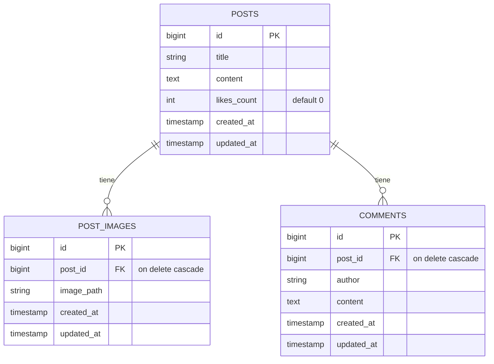

# API REST tipo Facebook con Laravel

API RESTful que simula las interacciones básicas de una red social: **publicaciones con múltiples imágenes, comentarios y "Me gusta"**. Se validó con Postman y con pruebas automáticas (PHPUnit).

| | |
|---|---|
| **Autor** | Juan Camilo Calderon (trabajo individual) |
| **Materia** | Arquitectura y Desarrollo Backend |
| **Institución** | Universidad Autónoma de Bucaramanga (UNAB) |
| **Docente** | Fabian Enrique Suarez Carvajal |

---

## Tecnologías

- PHP 8.4 · Laravel 13
- SQLite
- Eloquent ORM y File Storage (disco `public`)
- PHPUnit (pruebas feature)
- Postman (colección exportada en `facebook-api-postman-collection.json`)

## Requisitos

| Herramienta | Versión |
|---|---|
| PHP | 8.4 o superior, con las extensiones `pdo_sqlite`, `fileinfo` y `gd` |
| Composer | 2.x |
| Postman | Última versión |

## Instalación paso a paso

```bash
# 1. Clonar el repositorio
git clone https://github.com/CamiloCalder0n/-facebook-api.git facebook-api
cd facebook-api

# 2. Instalar dependencias
composer install

# 3. Crear el archivo de entorno y la llave de la aplicación
cp .env.example .env
php artisan key:generate

# 4. Crear la base de datos SQLite (en .env ya viene DB_CONNECTION=sqlite)
touch database/database.sqlite

# 5. Ejecutar las migraciones
php artisan migrate

# 6. Crear el enlace simbólico para servir las imágenes
php artisan storage:link

# 7. Levantar el servidor
php artisan serve
# Servidor corriendo en http://127.0.0.1:8000
```

> Opcional: en `.env` puedes poner `APP_NAME="Facebook API"` y `APP_URL=http://127.0.0.1:8000`.

## Endpoints

Todos los endpoints están bajo el prefijo `/api`.

| Método | Ruta | Content-Type | Body | Éxito | Errores posibles |
|---|---|---|---|---|---|
| POST | `/api/posts` | `multipart/form-data` | `title`, `content`, `images[]` (archivos) | **201** | 422 |
| GET | `/api/posts` | `application/json` | — | **200** | — |
| GET | `/api/posts/{id}` | `application/json` | — | **200** | 404 |
| POST | `/api/posts/{id}/comments` | `application/json` | `author`, `content` | **201** | 404, 422 |
| GET | `/api/posts/{id}/comments` | `application/json` | — | **200** | 404 |
| POST | `/api/posts/{id}/like` | `application/json` | — | **200** | 404 |
| DELETE | `/api/posts/{id}` | `application/json` | — | **204** | 404 |

Si se usa un método que la ruta no acepta (por ejemplo `GET /api/posts/1/like`), la API responde **405 Method Not Allowed**.

### Validaciones

| Campo | Reglas |
|---|---|
| `title` | obligatorio, texto, máximo 255 caracteres |
| `content` | obligatorio, texto |
| `images` | opcional, arreglo |
| `images.*` | imagen `jpeg`, `png`, `jpg` o `gif`, máximo 2 MB |
| `author` (comentario) | obligatorio, texto, máximo 100 caracteres |
| `content` (comentario) | obligatorio, texto |

## Ejemplos de request y response

### Crear publicación · `POST /api/posts` → 201

Body `form-data`: `title` = `Mi primera publicación`, `content` = `Hola a todos, comparto fotos de mi viaje.`, `images[]` = foto 1, `images[]` = foto 2.

```json
{
  "title": "Mi primera publicación",
  "content": "Hola a todos, comparto fotos de mi viaje.",
  "updated_at": "2026-10-08T17:24:06.000000Z",
  "created_at": "2026-10-08T17:24:06.000000Z",
  "id": 1,
  "images": [
    {
      "id": 1,
      "post_id": 1,
      "image_path": "posts/wqSqNnm4GtP9qqvqt7uXKytWPBKSLEGcSzD8cpA0.jpg",
      "created_at": "2026-10-08T17:24:06.000000Z",
      "updated_at": "2026-10-08T17:24:06.000000Z",
      "image_url": "http://127.0.0.1:8000/storage/posts/wqSqNnm4GtP9qqvqt7uXKytWPBKSLEGcSzD8cpA0.jpg"
    }
  ]
}
```

### Listar publicaciones · `GET /api/posts` → 200

```json
[
  {
    "id": 1,
    "title": "Mi primera publicación",
    "content": "Hola a todos, comparto fotos de mi viaje.",
    "likes_count": 0,
    "created_at": "2026-10-08T17:24:06.000000Z",
    "updated_at": "2026-10-08T17:24:06.000000Z",
    "images": [
      {
        "id": 1,
        "post_id": 1,
        "image_path": "posts/wqSqNnm4GtP9qqvqt7uXKytWPBKSLEGcSzD8cpA0.jpg",
        "image_url": "http://127.0.0.1:8000/storage/posts/wqSqNnm4GtP9qqvqt7uXKytWPBKSLEGcSzD8cpA0.jpg"
      }
    ],
    "comments": []
  }
]
```

### Ver publicación · `GET /api/posts/1` → 200

Devuelve un solo objeto con la misma estructura de cada elemento del listado: `images` (con `image_url`) y `comments`.

### Agregar comentario · `POST /api/posts/1/comments` → 201

Request (`raw` → JSON):

```json
{"author": "Carlos Gómez", "content": "¡Qué buenas fotos!"}
```

Response:

```json
{
  "author": "Carlos Gómez",
  "content": "¡Qué buenas fotos!",
  "post_id": 1,
  "updated_at": "2026-10-08T17:30:55.000000Z",
  "created_at": "2026-10-08T17:30:55.000000Z",
  "id": 1
}
```

### Listar comentarios · `GET /api/posts/1/comments` → 200

```json
[
  {
    "id": 1,
    "post_id": 1,
    "author": "Carlos Gómez",
    "content": "¡Qué buenas fotos!",
    "created_at": "2026-10-08T17:30:55.000000Z",
    "updated_at": "2026-10-08T17:30:55.000000Z"
  }
]
```

### Dar like · `POST /api/posts/1/like` → 200

```json
{
  "message": "Me gusta añadido correctamente",
  "likes_count": 1
}
```

### Eliminar publicación · `DELETE /api/posts/1` → 204

Sin cuerpo de respuesta. Se borran el post, sus imágenes físicas en `storage/app/public/posts/` y, por cascada, sus filas en `post_images` y `comments`.

### Errores

**422 · Validación** (por ejemplo, crear sin `title`):

```json
{
  "message": "The title field is required.",
  "errors": {
    "title": ["The title field is required."]
  }
}
```

**422 · Archivo que no es imagen** (un PDF en `images[]`):

```json
{
  "message": "The images.0 field must be an image. (and 1 more error)",
  "errors": {
    "images.0": [
      "The images.0 field must be an image.",
      "The images.0 field must be a file of type: jpeg, png, jpg, gif."
    ]
  }
}
```

**404 · Recurso inexistente** (`GET /api/posts/9999`):

```json
{"message": "No query results for model [App\\Models\\Post] 9999"}
```

**405 · Método no permitido** (`GET /api/posts/1/like`):

```json
{"message": "The GET method is not supported for route api/posts/1/like. Supported methods: POST."}
```

> Con `APP_DEBUG=true` (entorno local), las respuestas 404 y 405 incluyen además `exception`, `file`, `line` y `trace`.

## Modelo de datos



Relaciones Eloquent:

- `Post` → `hasMany(PostImage)` y `hasMany(Comment)`
- `PostImage` → `belongsTo(Post)`
- `Comment` → `belongsTo(Post)`

## Cómo probar

### Postman

1. Importar `facebook-api-postman-collection.json` (**Import** → seleccionar el archivo).
2. La colección ya trae la variable `base_url` = `http://127.0.0.1:8000`. Todas las URLs usan `{{base_url}}/api/...`.
3. Todas las requests llevan el header `Accept: application/json`.
4. En **Crear publicación con imágenes**, los campos `images[]` son de tipo **File**: hay que volver a seleccionar las fotos, porque la colección guarda la ruta local del equipo donde se exportó. Un archivo no se puede mandar dentro de un JSON raw; se usa `form-data`.
5. Orden recomendado: Crear → Listar → Ver → Comentar → Listar comentarios → Like → (Casos de error) → Eliminar.

La colección incluye la carpeta **Casos De Error**: 422 sin título, 422 sin header Accept, 422 imagen no válida (PDF), 422 comentario sin autor, 405 GET a like y 404 post inexistente.

### Pruebas automáticas

```bash
php artisan test
```

Hay 15 pruebas: 13 de la API en `tests/Feature/PostApiTest.php` y `tests/Feature/CommentApiTest.php`, más los 2 ejemplos de Laravel. Usan `RefreshDatabase` y `Storage::fake('public')`. Cubren crear con imágenes, validaciones 422, 404, 405, like, borrado en cascada y la eliminación de archivos físicos.

## Decisiones de diseño

- **REST: la URL es el sustantivo y el método HTTP es el verbo.** No hay verbos en las rutas (nada de `/api/obtener-posts`). `like` también es un sustantivo: el recurso "me gusta".
- **"Like" es POST:** dar me gusta crea una interacción nueva sobre el post. Aunque no lleva body, el servidor modifica el estado (incrementa `likes_count`).
- **Códigos HTTP correctos:**
  - **201** al crear un post o un comentario.
  - **204** al eliminar (éxito, sin cuerpo).
  - **422** cuando los datos llegan pero no pasan la validación.
  - **404** si el recurso no existe (`findOrFail`).
  - Nunca se responde `200` con un `{"error": ...}`.
- **Sin CSRF:** las rutas de `routes/api.php` son *stateless*: no usan sesión ni el middleware CSRF de las rutas web. Laravel les agrega el prefijo `/api` automáticamente.
- **Borrado en cascada + borrado físico:** las llaves foráneas de `post_images` y `comments` tienen `ON DELETE CASCADE`, así que la base de datos elimina las filas hijas. Antes de borrar el post, el controlador elimina los archivos de imagen del disco con `Storage::disk('public')->delete()`, para no dejar archivos huérfanos.
- **`image_url`:** cada imagen incluye su URL pública completa (`asset('storage/...')`). Funciona gracias al enlace simbólico de `php artisan storage:link`.
- **Header `Accept: application/json`:**
  - En Laravel 10/11, sin este header un error de validación **redirige** (302) en lugar de devolver JSON.
  - En Laravel 13, `bootstrap/app.php` trae configurado `shouldRenderJsonWhen` para las rutas `api/*`, así que la API responde **422 en JSON** aunque el cliente no envíe el header. Se comprobó con la request "422 - Sin header Accept".
  - Aun así, todas las requests envían `Accept: application/json` como buena práctica.

## Evidencia de proceso (commits)

El historial sigue **Conventional Commits** en español, un commit por cada bloque del taller:

| # | Commit |
|---|---|
| 1 | `feat: crear proyecto Laravel` |
| 2 | `feat: crear modelos y migraciones para posts, comentarios e imágenes` |
| 3 | `feat: configurar relaciones entre Post, Comment y PostImage` |
| 4 | `feat: implementar CRUD y lógica de likes` |
| 5 | `feat: registrar endpoints de la API REST` |
| 6 | `test: agregar pruebas feature de la API` |
| 7 | `test: exportar colección de Postman` |
| 8 | `docs: agregar README del proyecto` |

En las pruebas con Postman no aparecieron errores de código, por eso no hay commits `fix:`.
