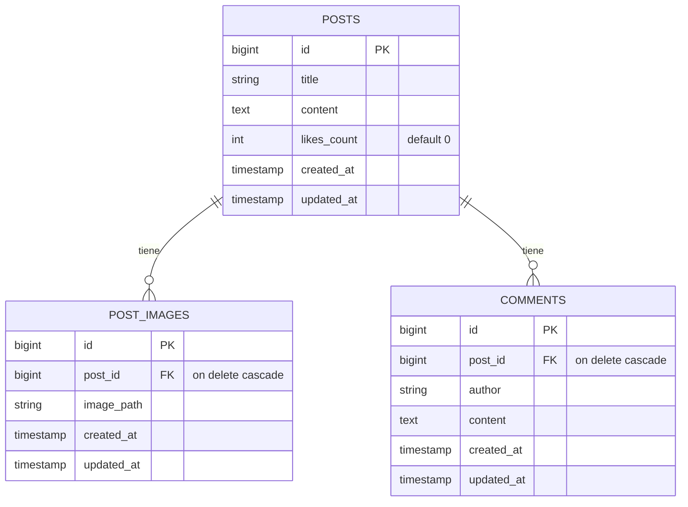
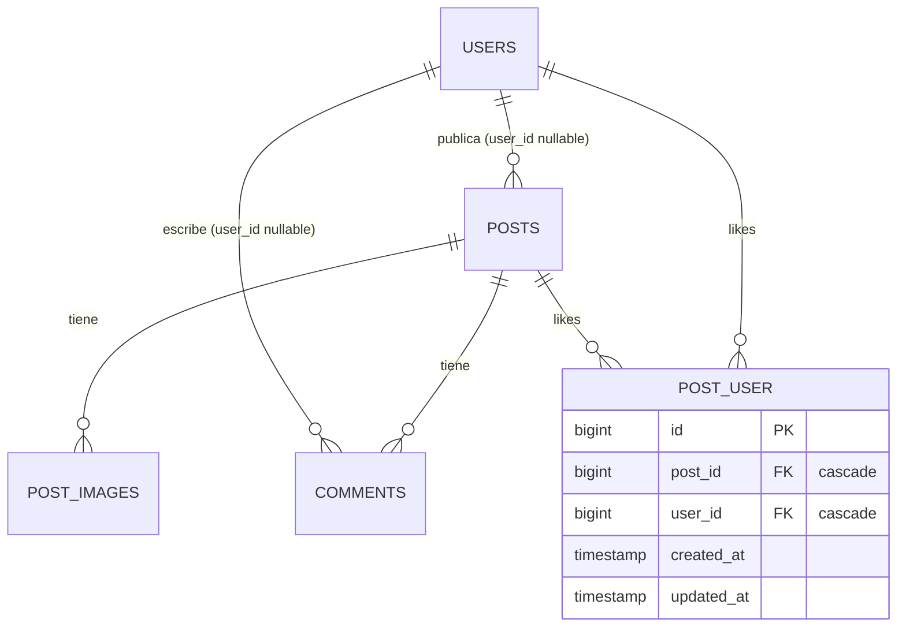

# API REST tipo Facebook con Laravel

API RESTful que simula las interacciones básicas de una red social: **publicaciones con múltiples imágenes, comentarios y "Me gusta"**. Se validó con Postman y con pruebas automáticas (PHPUnit).

> **Parte 1** (API básica, tag [`parte-1`](https://github.com/CamiloCalder0n/-facebook-api/tree/parte-1)) y **Parte 2** (retos avanzados: autenticación, likes por usuario, paginación, búsqueda, correo, versionado y documentación). Las secciones de Endpoints y Ejemplos describen la Parte 1; los cambios de la Parte 2 están en [Parte 2 · Retos avanzados](#parte-2--retos-avanzados).

| | |
|---|---|
| **Autor** | Juan Camilo Calderon (trabajo individual) |
| **Materia** | Arquitectura y Desarrollo Backend |
| **Institución** | Universidad Autónoma de Bucaramanga (UNAB) |
| **Docente** | Fabian Enrique Suarez Carvajal |

---

## Tecnologías

- PHP 8.4 · Laravel 13
- SQLite
- Eloquent ORM y File Storage (disco `public`)
- PHPUnit (pruebas feature)
- Postman (colecciones `facebook-api-postman-collection.json` y `facebook-api-parte2-postman-collection.json`)
- Laravel Sanctum (tokens Bearer) · Scribe (documentación en `/docs`) — Parte 2

## Requisitos

| Herramienta | Versión |
|---|---|
| PHP | 8.4 o superior, con las extensiones `pdo_sqlite`, `fileinfo` y `gd` |
| Composer | 2.x |
| Postman | Última versión |

## Instalación paso a paso

```bash
# 1. Clonar el repositorio
git clone https://github.com/CamiloCalder0n/-facebook-api.git facebook-api
cd facebook-api

# 2. Instalar dependencias
composer install

# 3. Crear el archivo de entorno y la llave de la aplicación
cp .env.example .env
php artisan key:generate

# 4. Crear la base de datos SQLite (en .env ya viene DB_CONNECTION=sqlite)
touch database/database.sqlite

# 5. Ejecutar las migraciones
php artisan migrate

# 6. Crear el enlace simbólico para servir las imágenes
php artisan storage:link

# 7. Levantar el servidor
php artisan serve
# Servidor corriendo en http://127.0.0.1:8000
```

> Opcional: en `.env` puedes poner `APP_NAME="Facebook API"` y `APP_URL=http://127.0.0.1:8000`.

## Endpoints

> Esta tabla es la de la **Parte 1** (sin autenticación). En la Parte 2 crear, borrar, dar like y comentar piden token, y el listado viene paginado: ver [Parte 2](#parte-2--retos-avanzados).

Todos los endpoints están bajo el prefijo `/api`.

| Método | Ruta | Content-Type | Body | Éxito | Errores posibles |
|---|---|---|---|---|---|
| POST | `/api/posts` | `multipart/form-data` | `title`, `content`, `images[]` (archivos) | **201** | 422 |
| GET | `/api/posts` | `application/json` | — | **200** | — |
| GET | `/api/posts/{id}` | `application/json` | — | **200** | 404 |
| POST | `/api/posts/{id}/comments` | `application/json` | `author`, `content` | **201** | 404, 422 |
| GET | `/api/posts/{id}/comments` | `application/json` | — | **200** | 404 |
| POST | `/api/posts/{id}/like` | `application/json` | — | **200** | 404 |
| DELETE | `/api/posts/{id}` | `application/json` | — | **204** | 404 |

Si se usa un método que la ruta no acepta (por ejemplo `GET /api/posts/1/like`), la API responde **405 Method Not Allowed**.

### Validaciones

| Campo | Reglas |
|---|---|
| `title` | obligatorio, texto, máximo 255 caracteres |
| `content` | obligatorio, texto |
| `images` | opcional, arreglo |
| `images.*` | imagen `jpeg`, `png`, `jpg` o `gif`, máximo 2 MB |
| `author` (comentario) | obligatorio, texto, máximo 100 caracteres |
| `content` (comentario) | obligatorio, texto |

## Ejemplos de request y response

### Crear publicación · `POST /api/posts` → 201

Body `form-data`: `title` = `Mi primera publicación`, `content` = `Hola a todos, comparto fotos de mi viaje.`, `images[]` = foto 1, `images[]` = foto 2.

```json
{
  "title": "Mi primera publicación",
  "content": "Hola a todos, comparto fotos de mi viaje.",
  "updated_at": "2026-10-08T17:24:06.000000Z",
  "created_at": "2026-10-08T17:24:06.000000Z",
  "id": 1,
  "images": [
    {
      "id": 1,
      "post_id": 1,
      "image_path": "posts/wqSqNnm4GtP9qqvqt7uXKytWPBKSLEGcSzD8cpA0.jpg",
      "created_at": "2026-10-08T17:24:06.000000Z",
      "updated_at": "2026-10-08T17:24:06.000000Z",
      "image_url": "http://127.0.0.1:8000/storage/posts/wqSqNnm4GtP9qqvqt7uXKytWPBKSLEGcSzD8cpA0.jpg"
    }
  ]
}
```

### Listar publicaciones · `GET /api/posts` → 200

```json
[
  {
    "id": 1,
    "title": "Mi primera publicación",
    "content": "Hola a todos, comparto fotos de mi viaje.",
    "likes_count": 0,
    "created_at": "2026-10-08T17:24:06.000000Z",
    "updated_at": "2026-10-08T17:24:06.000000Z",
    "images": [
      {
        "id": 1,
        "post_id": 1,
        "image_path": "posts/wqSqNnm4GtP9qqvqt7uXKytWPBKSLEGcSzD8cpA0.jpg",
        "image_url": "http://127.0.0.1:8000/storage/posts/wqSqNnm4GtP9qqvqt7uXKytWPBKSLEGcSzD8cpA0.jpg"
      }
    ],
    "comments": []
  }
]
```

### Ver publicación · `GET /api/posts/1` → 200

Devuelve un solo objeto con la misma estructura de cada elemento del listado: `images` (con `image_url`) y `comments`.

### Agregar comentario · `POST /api/posts/1/comments` → 201

Request (`raw` → JSON):

```json
{"author": "Carlos Gómez", "content": "¡Qué buenas fotos!"}
```

Response:

```json
{
  "author": "Carlos Gómez",
  "content": "¡Qué buenas fotos!",
  "post_id": 1,
  "updated_at": "2026-10-08T17:30:55.000000Z",
  "created_at": "2026-10-08T17:30:55.000000Z",
  "id": 1
}
```

### Listar comentarios · `GET /api/posts/1/comments` → 200

```json
[
  {
    "id": 1,
    "post_id": 1,
    "author": "Carlos Gómez",
    "content": "¡Qué buenas fotos!",
    "created_at": "2026-10-08T17:30:55.000000Z",
    "updated_at": "2026-10-08T17:30:55.000000Z"
  }
]
```

### Dar like · `POST /api/posts/1/like` → 200

```json
{
  "message": "Me gusta añadido correctamente",
  "likes_count": 1
}
```

### Eliminar publicación · `DELETE /api/posts/1` → 204

Sin cuerpo de respuesta. Se borran el post, sus imágenes físicas en `storage/app/public/posts/` y, por cascada, sus filas en `post_images` y `comments`.

### Errores

**422 · Validación** (por ejemplo, crear sin `title`):

```json
{
  "message": "The title field is required.",
  "errors": {
    "title": ["The title field is required."]
  }
}
```

**422 · Archivo que no es imagen** (un PDF en `images[]`):

```json
{
  "message": "The images.0 field must be an image. (and 1 more error)",
  "errors": {
    "images.0": [
      "The images.0 field must be an image.",
      "The images.0 field must be a file of type: jpeg, png, jpg, gif."
    ]
  }
}
```

**404 · Recurso inexistente** (`GET /api/posts/9999`):

```json
{"message": "No query results for model [App\\Models\\Post] 9999"}
```

**405 · Método no permitido** (`GET /api/posts/1/like`):

```json
{"message": "The GET method is not supported for route api/posts/1/like. Supported methods: POST."}
```

> Con `APP_DEBUG=true` (entorno local), las respuestas 404 y 405 incluyen además `exception`, `file`, `line` y `trace`.

## Modelo de datos



Relaciones Eloquent:

- `Post` → `hasMany(PostImage)` y `hasMany(Comment)`
- `PostImage` → `belongsTo(Post)`
- `Comment` → `belongsTo(Post)`

## Cómo probar

### Postman

1. Importar `facebook-api-postman-collection.json` (**Import** → seleccionar el archivo).
2. La colección ya trae la variable `base_url` = `http://127.0.0.1:8000`. Todas las URLs usan `{{base_url}}/api/...`.
3. Todas las requests llevan el header `Accept: application/json`.
4. En **Crear publicación con imágenes**, los campos `images[]` son de tipo **File**: hay que volver a seleccionar las fotos, porque la colección guarda la ruta local del equipo donde se exportó. Un archivo no se puede mandar dentro de un JSON raw; se usa `form-data`.
5. Orden recomendado: Crear → Listar → Ver → Comentar → Listar comentarios → Like → (Casos de error) → Eliminar.

La colección incluye la carpeta **Casos De Error**: 422 sin título, 422 sin header Accept, 422 imagen no válida (PDF), 422 comentario sin autor, 405 GET a like y 404 post inexistente.

### Pruebas automáticas

```bash
php artisan test
```

Hay 15 pruebas: 13 de la API en `tests/Feature/PostApiTest.php` y `tests/Feature/CommentApiTest.php`, más los 2 ejemplos de Laravel. Usan `RefreshDatabase` y `Storage::fake('public')`. Cubren crear con imágenes, validaciones 422, 404, 405, like, borrado en cascada y la eliminación de archivos físicos.

## Decisiones de diseño

- **REST: la URL es el sustantivo y el método HTTP es el verbo.** No hay verbos en las rutas (nada de `/api/obtener-posts`). `like` también es un sustantivo: el recurso "me gusta".
- **"Like" es POST:** dar me gusta crea una interacción nueva sobre el post. Aunque no lleva body, el servidor modifica el estado (incrementa `likes_count`).
- **Códigos HTTP correctos:**
  - **201** al crear un post o un comentario.
  - **204** al eliminar (éxito, sin cuerpo).
  - **422** cuando los datos llegan pero no pasan la validación.
  - **404** si el recurso no existe (`findOrFail`).
  - Nunca se responde `200` con un `{"error": ...}`.
- **Sin CSRF:** las rutas de `routes/api.php` son *stateless*: no usan sesión ni el middleware CSRF de las rutas web. Laravel les agrega el prefijo `/api` automáticamente.
- **Borrado en cascada + borrado físico:** las llaves foráneas de `post_images` y `comments` tienen `ON DELETE CASCADE`, así que la base de datos elimina las filas hijas. Antes de borrar el post, el controlador elimina los archivos de imagen del disco con `Storage::disk('public')->delete()`, para no dejar archivos huérfanos.
- **`image_url`:** cada imagen incluye su URL pública completa (`asset('storage/...')`). Funciona gracias al enlace simbólico de `php artisan storage:link`.
- **Header `Accept: application/json`:**
  - En Laravel 10/11, sin este header un error de validación **redirige** (302) en lugar de devolver JSON.
  - En Laravel 13, `bootstrap/app.php` trae configurado `shouldRenderJsonWhen` para las rutas `api/*`, así que la API responde **422 en JSON** aunque el cliente no envíe el header. Se comprobó con la request "422 - Sin header Accept".
  - Aun así, todas las requests envían `Accept: application/json` como buena práctica.

## Parte 2 · Retos avanzados

Guía del taller: `docs/Taller_Parte_2_API_REST.md`. Todo cambio de esquema va en migraciones nuevas (las de la Parte 1 no se editaron).

### Modelo de datos (Parte 2)



`post_user` tiene `UNIQUE(post_id, user_id)`: la base de datos también impide un like repetido. `user_id` en `posts` y `comments` es `nullable` porque los registros de la Parte 1 no tienen dueño.

### Autenticación (Reto 1 · Sanctum)

Sanctum ya venía instalado desde la Parte 1 (`php artisan install:api`), por eso **no** se corrió la "Recomendación" del taller: publicar de nuevo su configuración duplica la migración de `personal_access_tokens` y `migrate` falla.

```bash
# 1. Registrarse (201) o iniciar sesión (200): ambos devuelven un token
curl -X POST http://127.0.0.1:8000/api/v1/register -H "Accept: application/json" \
  -d name="Ana" -d email="ana@example.com" -d password="secreto123" -d password_confirmation="secreto123"

curl -X POST http://127.0.0.1:8000/api/v1/login -H "Accept: application/json" \
  -d email="ana@example.com" -d password="secreto123"
# {"user":{...},"token":"1|AbCd..."}

# 2. Enviar el token en las rutas protegidas
curl http://127.0.0.1:8000/api/v1/user -H "Accept: application/json" -H "Authorization: Bearer 1|AbCd..."
```

- Login con credenciales malas → **401** `{"message":"Credenciales inválidas"}`.
- Ruta protegida sin token → **401** `{"message":"Unauthenticated."}`.
- `POST /logout` revoca **solo** el token con el que se hizo la petición.
- Borrar un post ajeno → **403** (`PostPolicy`). Los posts sin dueño de la Parte 1 no se pueden borrar.
- Al comentar, `author` se llena con el nombre del usuario autenticado; ya no se envía en el body.

### Endpoints (Parte 2)

Todas las rutas existen en `/api/v1/...` y, con las mismas URLs de la Parte 1, en `/api/...` (alias de v1).

| Método | Ruta | Auth | Éxito | Errores |
|---|---|---|---|---|
| POST | `/register` | — | 201 + token | 422 |
| POST | `/login` | — | 200 + token | 401, 422 |
| POST | `/logout` | Bearer | 200 | 401 |
| GET | `/user` | Bearer | 200 | 401 |
| GET | `/posts?page=&search=` | — | 200 (paginado) | — |
| GET | `/posts/{id}` | — | 200 | 404 |
| POST | `/posts` | Bearer | 201 | 401, 422 |
| DELETE | `/posts/{id}` | Bearer (solo dueño) | 204 | 401, 403, 404 |
| POST | `/posts/{id}/like` | Bearer | 200 | 401, 404, 409 |
| GET | `/posts/{id}/comments` | — | 200 | 404 |
| POST | `/posts/{id}/comments` | Bearer | 201 (+ correo al dueño) | 401, 404, 422 |
| GET | `/api/v2/posts`, `/api/v2/posts/{id}` | — | 200 (formato v2) | 404 |
| GET | `/docs` | — | 200 | — |

### Paginación y búsqueda (Retos 2 y 4)

`GET /api/v1/posts` devuelve bloques de 10 con la información de paginación:

```json
{
  "current_page": 1,
  "data": [ { "id": 15, "title": "...", "user": {"id": 1, "name": "Ana"}, "images": [], "comments": [] } ],
  "first_page_url": "http://127.0.0.1:8000/api/v1/posts?page=1",
  "last_page": 2,
  "next_page_url": "http://127.0.0.1:8000/api/v1/posts?page=2",
  "per_page": 10,
  "prev_page_url": null,
  "total": 15
}
```

- `?page=2` trae el siguiente bloque. Una página fuera de rango devuelve 200 con `data` vacío.
- `?search=viaje` filtra en SQL por título **o** contenido (`LIKE %viaje%`). El `OR` va agrupado para no mezclarse con otros filtros.
- Se puede combinar: `?search=viaje&page=2`. Los enlaces de página conservan `search` (`withQueryString()`).

### Likes por usuario (Reto 3)

- Cada like se guarda en la tabla pivote `post_user` (relación muchos a muchos `Post::likers()` ↔ `User::likedPosts()`).
- Primer like → **200** `{"message":"Me gusta añadido correctamente","likes_count":1}`.
- El mismo usuario otra vez → **409 Conflict** `{"message":"Ya diste like a esta publicación","likes_count":1}`.
- `likes_count` se recalcula con el conteo real de `post_user`. Si dos peticiones del mismo usuario llegan a la vez, el índice único rechaza la segunda y la API responde 409, no 500.

### Correo al comentar (Reto 5)

- Al comentar un post ajeno se envía el Mailable `NewCommentMail` (asunto **"Nuevo comentario"**) al dueño del post, con el título, quién comentó y el texto.
- No se envía si el dueño comenta su propio post ni en los posts sin dueño de la Parte 1.
- Si el servidor de correo falla, el comentario igual se guarda y responde 201 (el error queda en el log).
- **Desarrollo:** `MAIL_MAILER=log`, el correo queda en `storage/logs/laravel.log`.
- **Mailtrap Sandbox:** en tu `.env` pon `MAIL_MAILER=smtp`, `MAIL_HOST=sandbox.smtp.mailtrap.io`, `MAIL_PORT=2525` y el usuario/clave de tu bandeja. Las credenciales nunca van al repositorio.
- **Tests:** `Mail::fake()`.

### Versionado (Reto 6)

| Versión | Prefijo | Controladores | Formato |
|---|---|---|---|
| v1 | `/api/v1/...` | `App\Http\Controllers\Api\V1\*` | El de la Parte 1 + auth + paginación |
| alias | `/api/...` | los mismos de v1 | idéntico a v1 |
| v2 | `/api/v2/posts` | `App\Http\Controllers\Api\V2\PostController` | API Resources |

Ejemplo de v2 (`GET /api/v2/posts/1`):

```json
{
  "data": {
    "id": 1,
    "title": "Mi viaje",
    "content": "Fotos",
    "author": {"id": 1, "name": "Ana"},
    "images": [{"id": 1, "url": "http://127.0.0.1:8000/storage/posts/abc.jpg"}],
    "likes_count": 2,
    "comments_count": 3,
    "created_at": "2026-10-09T05:00:00.000000Z",
    "updated_at": "2026-10-09T05:00:00.000000Z"
  }
}
```

v2 cambia el formato (autor como objeto, imágenes `{id, url}`, `comments_count` en lugar de la lista de comentarios). Por eso es una versión nueva: v1 sigue igual para quien ya la usa.

> **Ojo con el alias:** `/api/...` mantiene las URLs de la Parte 1, pero no su comportamiento. El listado ahora viene paginado y crear, comentar, borrar y dar like piden token, así que un cliente escrito para la Parte 1 tendría que ajustarse. Desde aquí, los cambios incompatibles van en una versión nueva (como v2) sin tocar v1.

### Documentación (Reto 7 · Scribe)

- La documentación está en **http://127.0.0.1:8000/docs** (con `php artisan serve` corriendo).
- Desde `/docs` también se descargan la colección de Postman (`/docs.postman`) y la especificación OpenAPI (`/docs.openapi`).
- Se documentan `api/v1/*` y `api/v2/*`. El alias sin versión es idéntico a v1 y se omite para no duplicar.
- La documentación sale de los docblocks de los controladores (`@group`, `@authenticated`, `@bodyParam`, `@queryParam`, `@response`).
- Si cambias un endpoint, regenera con `php artisan scribe:generate`.

### Pruebas

```bash
php artisan test
```

67 pruebas (299 aserciones): 66 en `tests/Feature/` y 1 en `tests/Unit/` (el ejemplo de Laravel).

| Archivo | Qué cubre |
|---|---|
| `AuthApiTest` | Registro, login, logout y `/user` |
| `PostApiTest` | Publicaciones, 401/403/404 y borrado físico |
| `CommentApiTest` | Comentarios |
| `LikeApiTest` | Likes: 409, carrera y conteo real |
| `PaginationApiTest` | Paginación |
| `SearchApiTest` | Búsqueda |
| `CommentMailTest` | Correo con `Mail::fake()` |
| `VersioningApiTest` | v1, alias y v2 |
| `DocsTest` | `/docs` |
| `ExampleTest` (Feature y Unit) | Ejemplos que trae Laravel |

### Postman (Parte 2)

Colección `facebook-api-parte2-postman-collection.json`.

| Variable de colección | Para qué |
|---|---|
| `base_url` | URL del servidor |
| `token` | Token del usuario A, dueño de los posts |
| `token_b` | Token del usuario B |
| `post_id` | Post sobre el que se prueba |

- Los requests "Login A" y "Login B" guardan el token solos (pestaña Scripts).
- La colección se exporta con `token` y `token_b` vacíos.

## Preguntas guía

> Borrador para revisión de Cami. Ajustar con mis palabras antes de entregar.

**1. ¿Cómo se puede diferenciar entre un usuario autenticado y un usuario anónimo en una API REST?**
Como la API es *stateless*, no hay sesión: cada petición tiene que demostrar quién es. El usuario hace login y recibe un token. A partir de ahí lo envía en el header `Authorization: Bearer <token>`. El middleware `auth:sanctum` busca ese token en `personal_access_tokens`: si existe, `$request->user()` es ese usuario; si no viene o no es válido, la petición se trata como anónima y las rutas protegidas responden 401.

**2. ¿Qué ventaja tiene devolver resultados paginados en lugar de todos los registros a la vez?**
La respuesta tiene un tamaño acotado sin importar cuántos posts haya. La consulta a la base de datos es más liviana (`LIMIT`/`OFFSET`), se transfieren menos datos y el cliente (web o móvil) muestra algo rápido y carga más cuando lo necesita (scroll infinito, botón "siguiente"). Además la respuesta trae `total`, `last_page` y los enlaces, así el cliente sabe cómo navegar.

**3. ¿Qué problema tiene un contador global si varios usuarios interactúan a la vez?**
Con solo un número no se sabe quién dio like. Por eso el mismo usuario podía sumar likes infinitos y no había forma de evitarlo ni de quitarlo. Si dos peticiones leen y escriben el contador al mismo tiempo, una puede pisar a la otra y el número queda mal. Con la tabla `post_user` cada like es una fila con dueño, el índice único impide los repetidos y el total sale de contar filas reales.

**4. ¿Cómo afecta la búsqueda al flujo de la API y qué diferencias hay entre filtrar en SQL y hacerlo en el backend manualmente?**
El mismo endpoint `GET /posts` acepta un parámetro opcional (`?search=`) que cambia qué registros devuelve, sin crear rutas nuevas. Filtrar en SQL (`WHERE title LIKE ...`) hace que la base de datos devuelva solo lo que coincide, y se combina bien con la paginación. Filtrar en PHP obligaría a traer todos los posts a memoria y descartarlos uno por uno: es más lento, gasta más memoria y rompe la paginación, porque se contaría sobre datos ya recortados.

**5. ¿Qué ventajas tiene automatizar notificaciones por correo en una red social o plataforma de contenido?**
El dueño se entera de la actividad sin tener que entrar a revisar, lo que aumenta la participación y el regreso a la plataforma. El envío es consistente, porque siempre ocurre al guardar un comentario y no depende de que alguien se acuerde. Queda centralizado en un Mailable reutilizable, se puede probar con `Mail::fake()` y más adelante se puede pasar a una cola para no demorar la respuesta de la API.

**6. ¿Por qué es importante versionar una API cuando se agregan cambios significativos?**
Hay clientes (apps móviles, frontends, otros servicios) que ya dependen del formato actual y no se actualizan todos al mismo tiempo. Si se cambia el formato en la misma URL, esos clientes se rompen. Con versiones, los cambios incompatibles van en `/v2` mientras `/v1` sigue funcionando igual. Así cada cliente migra cuando pueda y la versión vieja se retira de forma planificada.

**7. ¿Por qué es más fácil mantener una API cuando la documentación está presente?**
Otros desarrolladores (y uno mismo después de un tiempo) pueden usar la API sin leer el código: ven cada ruta, el método, el body, si pide token y qué respuestas y códigos devuelve. Con Scribe la documentación se genera desde el código, así que es más fácil mantenerla al día. Además trae ejemplos y una colección de Postman lista, y reduce las preguntas y los errores de integración.

## Evidencia de proceso (commits)

El historial sigue **Conventional Commits** en español, un commit por cada bloque del taller:

| # | Commit |
|---|---|
| 1 | `feat: crear proyecto Laravel` |
| 2 | `feat: crear modelos y migraciones para posts, comentarios e imágenes` |
| 3 | `feat: configurar relaciones entre Post, Comment y PostImage` |
| 4 | `feat: implementar CRUD y lógica de likes` |
| 5 | `feat: registrar endpoints de la API REST` |
| 6 | `test: agregar pruebas feature de la API` |
| 7 | `test: exportar colección de Postman` |
| 8 | `docs: agregar README del proyecto` |

En las pruebas con Postman no aparecieron errores de código, por eso no hay commits `fix:`.

### Parte 2

| # | Commit |
|---|---|
| — | tag `parte-1` |
| 0 | `docs: agregar guía de la parte 2 del taller` |
| 1 | `feat: agregar registro e inicio de sesión con Sanctum` |
| 2 | `feat: proteger endpoints y asociar publicaciones y comentarios al usuario` |
| 3 | `feat: likes únicos por usuario con tabla pivote` |
| 4 | `feat: paginar el listado de publicaciones` |
| 5 | `feat: buscar publicaciones por título o contenido` |
| 6 | `feat: notificar por correo al dueño del post al comentar` |
| 7 | `feat: versionar la API en v1 y agregar v2` |
| 7b | `fix: no fallar el comentario si el correo no se puede enviar` |
| 8 | `docs: documentar la API con Scribe` |
| 9 | `test: completar pruebas de la parte 2` |
| 10 | `docs: actualizar README con la parte 2` |
| 11 | `fix: corregir conteo de pruebas en README y agregar lista de evidencias` |
| 12 | `test: exportar colección de Postman de la parte 2` |
